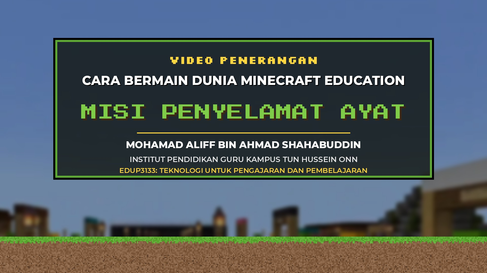
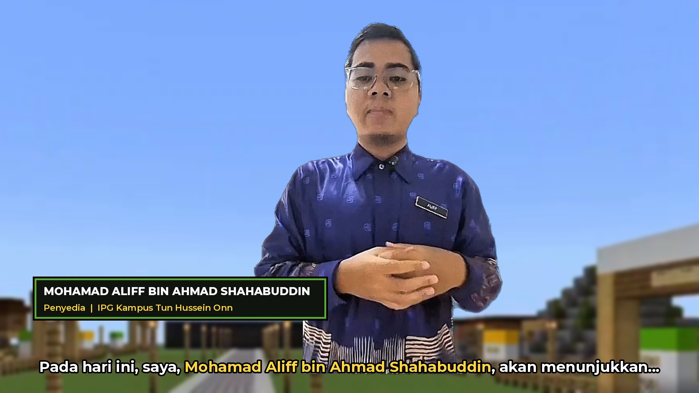
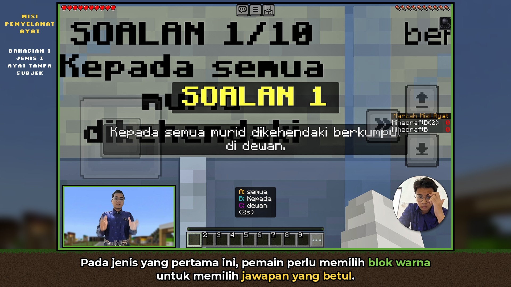
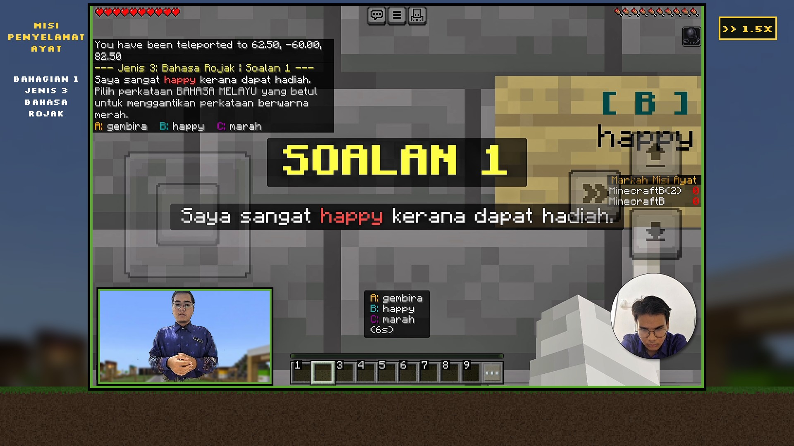
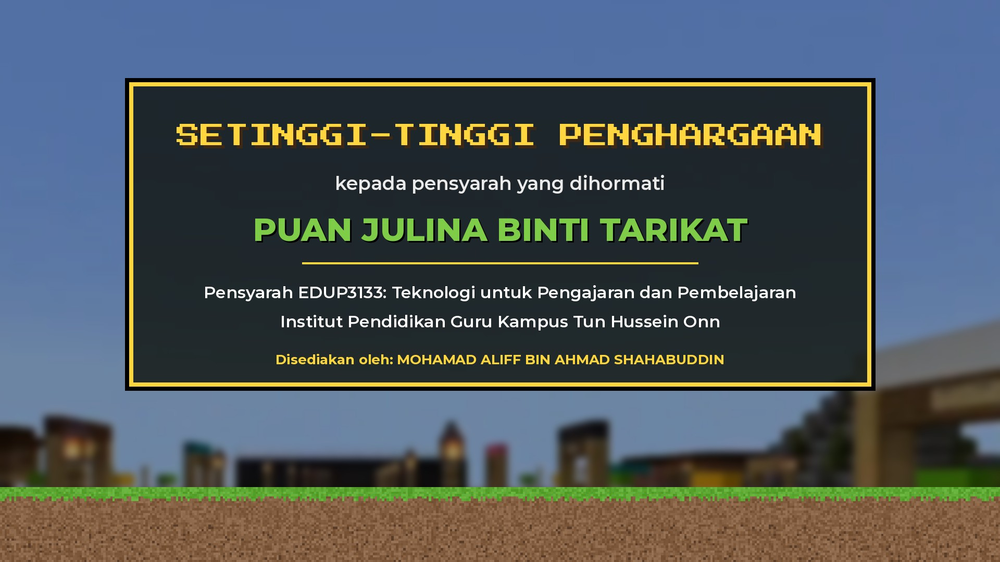

# STORYBOARD — VIDEO PENERANGAN: CARA BERMAIN DUNIA MINECRAFT EDUCATION — MISI PENYELAMAT AYAT

**Penyedia:** MOHAMAD ALIFF BIN AHMAD SHAHABUDDIN · **Pensyarah:** PUAN JULINA BINTI TARIKAT
**Institusi:** INSTITUT PENDIDIKAN GURU KAMPUS TUN HUSSEIN ONN · **Kursus:** EDUP3133: TEKNOLOGI UNTUK PENGAJARAN DAN PEMBELAJARAN

> Status: **DILULUSKAN — FASA D/E.** Fail asal di Google Drive tidak diubah.

### Keputusan pengguna (selepas semakan)
1. Facecam bulat (pemain bermain) **tidak diubah atau disentuh langsung**.
2. Nama "Aliff" — diluluskan; suara asal kekal.
3. Sari kata ikut sebutan sebenar (dunia Penyelamat, 5 warna, "Saya ucapkan kepada…").
4. Ayat terputus 15:44 dikekalkan.
5. Muzik chiptune lembut hanya pada pembukaan & penutup.
6. Kad penutup: ikut kesesuaian → baris kecil "Disediakan oleh: MOHAMAD ALIFF BIN AHMAD SHAHABUDDIN" dikekalkan di bawah teks penghargaan.
7. **Perubahan susun atur:** gameplay dibesarkan hampir skrin penuh — **1568×980** (saiz maksimum tanpa memotong gameplay; rakaman asal 16:10), rapat ke atas, dengan **jalur sari kata 100 px** di bawah. Sari kata 36 px.

---

## FASA A — ANALISIS

### Fail sumber
| Fail | Durasi | Video | Audio |
|---|---|---|---|
| `video penerangan tekno` (Google Drive, 1.35 GB) — satu-satunya fail dalam folder | **18:26.4** | H.264, **1728×1080** (16:10), 30 fps | AAC stereo 44.1 kHz |

### Struktur rakaman asal
| Masa asal | Kandungan | Paparan guru |
|---|---|---|
| 00:00 – 00:24 | Pengenalan guru (badan penuh, berdiri) | Guru sudah dipotong atas **latar hitam**, tetapi ada **sisa beg** di kiri bawah |
| 00:24 – 18:21 | Rakaman skrin gameplay (iPad) | (1) **Inset kamera** kiri bawah (498×278 px) — guru berdiri di **bilik tidur** (langsir biru, rak baju); (2) **bulatan facecam** iPad di kanan (kadang-kadang berpindah ke atas) — guru duduk |
| 18:21 – 18:26 | Skrin hitam kosong (5.1 s) | — |

**Tiada bahagian penghargaan/penutup dalam rakaman asal** — kad penutup akan dibina baharu mengikut teks yang anda tetapkan.

### Audio
- Suara guru jelas (purata −20 dB). Tiada muzik dalam rakaman asal. Hanya bunyi permainan ringan semasa senyap.
- Transkripsi automatik (Whisper large-v3-turbo) + semakan semula setiap jurang tanpa VAD untuk memastikan **tiada penerangan terlepas**.
- **20 blok penerangan** dan **16 bahagian senyap ≥ 6 s** dikenal pasti (jumlah senyap ≈ 9 min 20 s).

### Ketepatan nama dalam audio
| Masa asal | Disebut | Status |
|---|---|---|
| 00:04.7 – 00:05.7 | "Puan **Julina binti Tarikat**" | ✅ Jelas (keyakinan tinggi) |
| 00:12.8 – 00:14.6 | "saya, **Mohamad Aliff bin Ahmad Shahabuddin**" | ⚠️ **Sila semak** — perkataan "Aliff" berkeyakinan rendah dalam ASR (sebutan agak laju). Suara asal dikekalkan; sari kata guna ejaan betul. |

---

## FASA B — STORYBOARD

**Anggaran durasi akhir: ~15:35** (asal 18:26 → bahagian senyap dipercepat; semua penerangan kekal 1.0x).

Peraturan kelajuan yang digunakan:
- Penerangan + 0.8 s sebelum & 0.5 s selepas setiap ayat: **1.0x** (tiada perkataan terpotong).
- Senyap 6–20 s: **1.4x**; senyap ≥ 20 s: **1.5x**.
- Ramp 0.6 s (1.0 → 1.2/1.25 → 1.4/1.5) pada mula dan hujung setiap bahagian senyap; kembali ke 1.0x **sebelum** suara bermula.
- Audio dipercepat dengan *time-stretch* (atempo) — **nada tidak berubah**.
- Jeda < 6 s dikekalkan 1.0x.

| # | Mula (output) | Tamat (output) | Asal (rakaman) | Kandungan babak | Jenis penyuntingan | Kelajuan | Sari kata | Perubahan latar belakang |
|---|---|---|---|---|---|---|---|---|
| 0 | 00:00.0 | 00:09.0 | — (baharu) | Animasi pembukaan: VIDEO PENERANGAN / CARA BERMAIN DUNIA MINECRAFT EDUCATION / **MISI PENYELAMAT AYAT** + nama, institusi, kursus | Grafik tajuk animasi (blok jatuh, panel piksel), muzik latar lembut | — | Tiada (teks tajuk) | Landskap Minecraft dari dunia anda |
| 1 | 00:09.0 | 00:33.2 | 00:00.0–00:24.2 | Pengenalan guru (badan penuh): salam, penghargaan kepada **Puan Julina binti Tarikat**, memperkenalkan diri **Mohamad Aliff bin Ahmad Shahabuddin**, tujuan video. | Guru dipotong daripada latar, diletak di hadapan landskap Minecraft (kabur lembut). Lower-third nama penyedia. | 1.0x | Ya – nama ditebalkan/kuning | **Latar hitam asal (dengan sisa beg di kiri bawah) → landskap Minecraft** |
| 2 | 00:33.2 | 00:50.6 | 00:24.2–00:41.7 | Skrin utama Minecraft Education → Join Code → kod disahkan. | Gameplay + inset guru ; label bab 'MULA' | 1.0x | Ya | Inset: bilik → Minecraft |
| 3 | 00:50.6 | 01:02.5 | 00:41.7–00:59.6 | Skrin 'Connecting / Generating World' (tiada suara). | Gameplay + inset guru | 1.5x (ramp 1.0→1.5→1.0) | Tiada (lencana ⏩ 1.5x) | Inset: bilik → Minecraft |
| 4 | 01:02.5 | 01:41.2 | 00:59.6–01:38.5 | Paparan Selamat Datang, papan 'Selamat datang ke Misi Penyelamat Ayat', markah **+100 / −50**, mod individu & kumpulan, lobi contoh kesalahan ayat. | Gameplay + inset guru | 1.0x | Ya | Inset: bilik → Minecraft |
| 5 | 01:41.2 | 01:53.6 | 01:38.5–01:55.9 | Pemain berjalan di lobi (tiada suara). | Gameplay + inset guru | 1.4x (ramp 1.0→1.4→1.0) | Tiada | Inset: bilik → Minecraft |
| 6 | 01:53.6 | 02:31.7 | 01:55.9–02:34.2 | Gerbang **ungu** (berkumpulan), warna kumpulan, pintu **hijau** (individu), pijak blok hijau → Lobi Jenis 1 (30 saat membaca papan tanda). | Gameplay + inset guru | 1.0x | Ya | Inset: bilik → Minecraft |
| 7 | 02:31.7 | 02:50.1 | 02:34.2–03:01.8 | Lobi Jenis 1 – pemain membaca papan tanda, kiraan 30 saat (tiada suara). | Gameplay + inset guru | 1.5x (ramp 1.0→1.5→1.0) | Tiada | Inset: bilik → Minecraft |
| 8 | 02:50.1 | 03:52.0 | 03:01.8–04:04.0 | **Jenis 1: Ayat Tanpa Subjek** – Soalan 1 & 2: baca soalan, 3 pilihan, pijak **blok warna**, BETUL +100 + penerangan; perlu betul 5 soalan untuk ke Jenis 2. | Gameplay + inset guru ; label bab 'BAHAGIAN 1 · JENIS 1' | 1.0x | Ya | Inset: bilik → Minecraft |
| 9 | 03:52.0 | 04:43.5 | 04:04.0–05:21.2 | Jenis 1 – Soalan 3, 4, 5 dijawab (tiada suara). | Gameplay + inset guru | 1.5x (ramp 1.0→1.5→1.0) | Tiada | Inset: bilik → Minecraft |
| 10 | 04:43.5 | 06:06.1 | 05:21.2–06:47.4 | Lobi Jenis 2 (30 saat). Plat besi → lobi utama. **Jenis 2: Ayat Tidak Lengkap** – Soalan 1: **Peti 1 = subjek**, **Peti 2 = predikat**; rehat di lobi & blok **glowstone** untuk sambung. (Jeda 5–7 s di 5:41 & 6:40 dipercepat 1.4x) | Gameplay + inset guru ; label 'JENIS 2' | 1.0x (jeda: 1.4x) | Ya | Inset: bilik → Minecraft |
| 11 | 06:07.0 | 06:30.9 | 06:48.5–07:24.3 | Pemain membuka peti dan memilih kepingan ayat (tiada suara). | Gameplay + inset guru | 1.5x (ramp 1.0→1.5→1.0) | Tiada | Inset: bilik → Minecraft |
| 12 | 06:30.9 | 07:03.7 | 07:24.3–07:57.3 | Penerangan Peti 1 & Peti 2, letak ayat pada **bingkai** (item frame) yang disediakan. | Gameplay + inset guru | 1.0x | Ya | Inset: bilik → Minecraft |
| 13 | 07:03.7 | 07:34.7 | 07:57.3–08:43.9 | Jenis 2 – Soalan 2 & 3 (tiada suara). | Gameplay + inset guru | 1.5x (ramp 1.0→1.5→1.0) | Tiada | Inset: bilik → Minecraft |
| 14 | 07:34.7 | 08:05.5 | 08:43.9–09:14.9 | Jawapan salah → bilik pilihan (kembali ke lobi utama / teruskan). Perlu betul 5 soalan untuk ke Jenis 3. | Gameplay + inset guru | 1.0x | Ya | Inset: bilik → Minecraft |
| 15 | 08:05.5 | 09:41.1 | 09:14.9–11:38.4 | Jenis 2 – Soalan 4, 5 & 6 (termasuk SALAH −50), masuk ke Lobi Jenis 3 (tiada suara, 2 min 24 s). | Gameplay + inset guru | 1.5x (ramp 1.0→1.5→1.0) | Tiada | Inset: bilik → Minecraft |
| 16 | 09:41.1 | 10:35.9 | 11:38.4–12:42.5 | **Jenis 3: Bahasa Rojak** – Lobi 30 saat, aktiviti **parkour** (lompat blok ke blok) memilih jawapan; jatuh ke air → reset ke permulaan. | Gameplay + inset guru ; label 'JENIS 3' | 1.0x (jeda 29 s: 1.5x) | Ya | Inset: bilik → Minecraft |
| 17 | 10:35.9 | 11:04.0 | 12:42.5–13:24.6 | Jenis 3 – parkour soalan seterusnya (tiada suara). | Gameplay + inset guru | 1.5x (ramp 1.0→1.5→1.0) | Tiada | Inset: bilik → Minecraft |
| 18 | 11:04.0 | 11:42.2 | 13:24.6–14:05.3 | Perlu betul 5 soalan → **kawasan pemenang**, ucapan tahniah, pijak blok untuk papar markah & kedudukan. | Gameplay + inset guru | 1.0x (jeda 8 s: 1.4x) | Ya | Inset: bilik → Minecraft |
| 19 | 11:42.2 | 13:15.2 | 14:05.3–15:45.3 | Kembali ke lobi utama → pijak blok **hitam** → **Bahagian 2: Ekspedisi Ayat**; berinteraksi dengan **NPC**, papan tanda arahan, pusat permainan, 'Saya bersedia!', misi bina **ayat aktif & ayat pasif**. (Jeda 20 s di 14:35 dipercepat) | Gameplay + inset guru ; label 'BAHAGIAN 2' | 1.0x (jeda: 1.5x) | Ya | Inset: bilik → Minecraft |
| 20 | 13:16.2 | 13:42.8 | 15:46.4–16:26.4 | Pemain menaip ayat di stesen (Ladang Pertanian), BETUL +100 (tiada suara). | Gameplay + inset guru | 1.5x (ramp 1.0→1.5→1.0) | Tiada | Inset: bilik → Minecraft |
| 21 | 13:42.8 | 14:16.9 | 16:26.4–17:00.7 | Selepas bina ayat aktif–pasif → hujung stesen → blok hitam → **cabaran terakhir** (3 hakim), pilih satu jenis. | Gameplay + inset guru ; label 'CABARAN AKHIR' | 1.0x | Ya | Inset: bilik → Minecraft |
| 22 | 14:16.9 | 14:41.0 | 17:00.7–17:36.8 | Pemain menjawab soalan Hakim C1 (tiada suara). | Gameplay + inset guru | 1.5x (ramp 1.0→1.5→1.0) | Tiada | Inset: bilik → Minecraft |
| 23 | 14:41.0 | 15:17.0 | 17:36.8–18:13.1 | Bahagian **keputusan**, pijak blok **emas** → **pingat** ikut markah; kembali ke menu utama untuk tamat. | Gameplay + inset guru | 1.0x | Ya | Inset: bilik → Minecraft |
| 24 | 15:17.0 | 15:22.5 | 18:13.1–18:21.3 | Gameplay penutup (tiada suara) → fade ke penutup. Skrin hitam asal 5.1 s di hujung dibuang. | Gameplay + inset guru ; fade-out | 1.5x (ramp 1.0→1.5→1.0) | Tiada | Inset: bilik → Minecraft |
| 25 | 15:22.5 | 15:34.5 | — (baharu) | **SETINGGI-TINGGI PENGHARGAAN** kepada pensyarah yang dihormati **PUAN JULINA BINTI TARIKAT**, Pensyarah EDUP3133: Teknologi untuk Pengajaran dan Pembelajaran, Institut Pendidikan Guru Kampus Tun Hussein Onn | Kad penutup bertema Minecraft (sepadan pembukaan), muzik lembut, fade ke hitam | — | Tiada (teks kad) | Landskap Minecraft |

### Elemen visual tetap (semua babak gameplay)
- Kanvas 1920×1080: gameplay diskala ke **1568×980** (hampir skrin penuh, tiada potongan, tiada herotan), jalur sisi nipis 176 px (landskap Minecraft kabur dari dunia anda).
- **Jalur sari kata khas** di bawah gameplay → sari kata **tidak menutup gameplay** (hotbar, soalan, jawapan kekal jelas).
- Panel kiri: logo teks "MISI PENYELAMAT AYAT" + label bab semasa (Bahagian/Jenis). Panel kanan: lencana "⏩ 1.5x" hanya semasa bahagian dipercepat.

### Sari kata
- Fon Montserrat SemiBold 36 px (kata kunci Montserrat Bold), putih + garis luar hitam 4 px, maksimum 2 baris (~45 aksara/baris), diselaraskan dengan masa perkataan.
- Istilah penting **kuning** (cth. *Misi Penyelamat Ayat, +100 markah, −50 markah, subjek, predikat, ayat aktif, ayat pasif, pingat*), objek permainan **hijau** (cth. *blok warna, peti, glowstone, plat besi, NPC, bingkai, blok emas*).
- Nama ditulis tepat: **Mohamad Aliff bin Ahmad Shahabuddin**, **Puan Julina binti Tarikat**.
- Draf penuh sari kata (selepas pembetulan ejaan) — lihat bahagian di bawah.

### Penggantian latar belakang guru
- Teknik: **Robust Video Matting (ResNet-50)**, diproses berurutan bingkai demi bingkai (temporal) pada resolusi 2× untuk tepi rambut/bahu yang kemas.
- Babak 1 (intro): latar hitam + sisa beg dibuang → guru diletak di hadapan landskap Minecraft (dunia anda sendiri, kabur lembut) — sedikit ke kanan, lower-third nama di kiri.
- Babak 2–24: inset kamera kiri bawah — bilik tidur dibuang → landskap Minecraft, dengan bingkai piksel hijau. Facecam bulat **tidak disentuh**.
- Wajah, badan, pakaian dan pergerakan asal **tidak diubah**. Tiada avatar.

### Mockup (bingkai contoh — dijana daripada rakaman sebenar anda)
| | |
|---|---|
|  **Pembukaan** |  **Babak 1 – latar diganti** |
|  **Gameplay + sari kata** |  **Bahagian senyap 1.5x** |
|  **Penutup** | |

---

## PERKARA UNTUK KEPUTUSAN / SEMAKAN ANDA

1. **Bulatan facecam di kanan** (guru duduk, latar bilik) — (a) *[cadangan]* gantikan latar juga dengan Minecraft, (b) kekalkan seperti asal, atau (c) sembunyikan.
2. **00:12.8 – 00:14.6** — sila dengar sebutan nama "Mohamad Aliff bin Ahmad Shahabuddin" (keyakinan ASR rendah untuk "Aliff"). Suara asal kekal; tiada suara AI.
3. **00:21** — audio menyebut "dunia **Penyelamat**" (tanpa "Misi … Ayat"). Cadangan: sari kata ikut sebutan sebenar (tidak mereka dialog); tajuk & grafik tetap guna "MISI PENYELAMAT AYAT".
4. **02:03** — audio menyebut "terdapatnya **5 warna**: biru, merah, hijau dan kuning" (4 warna disenaraikan). Cadangan: ikut sebutan.
5. **00:03** — "Saya ucapkan kepada Puan Julina binti Tarikat…" (tiada perkataan seperti "terima kasih"). Cadangan: ikut sebutan.
6. **15:44 (asal)** — ayat "Pada bahagian kiri dan kanan bagi stesen tersebut, …" tiada sambungan dalam audio (diikuti 42 s senyap). Dikekalkan seperti asal.
7. **Muzik latar** — rakaman asal tiada muzik. Cadangan: muzik lembut gaya *chiptune* (dijana sendiri, bebas hak cipta) **hanya** pada pembukaan & penutup; tiada muzik semasa penerangan.
8. **Kad penutup** — rakaman asal tiada bahagian penghargaan; kad baharu akan dibina (lihat mockup 5). Baris "Disediakan oleh" boleh dibuang jika tidak mahu.
9. Skrin hitam 5.1 s di hujung rakaman asal akan dibuang (bukan gameplay).

**Spesifikasi eksport:** 1920×1080, 16:9, MP4, H.264 (CRF 18, High profile), AAC 192 kbps, 30 fps, sari kata Bahasa Melayu dibakar (burn-in) + fail `.srt` berasingan. Nama fail: `VIDEO_PENERANGAN_MISI_PENYELAMAT_AYAT_FINAL.mp4`.

---

## DRAF SARI KATA (masa asal | teks selepas pembetulan ejaan)

Pembetulan utama ASR: *Puan Craft → Minecraft*, *bersyarah → pensyarah*, *makah → markah*, *gebang berwarna umur → gerbang berwarna ungu*, *pemainan → permainan*, *zamro → zamrud*, *cebaran → cabaran*, *ucapan tanya → ucapan tahniah*, *memulukan → memulakan*, *pakor → parkour*, *station → stesen*. Sari kata akhir akan disusun semula kepada baris pendek mengikut masa perkataan.

```
00:00.9 | Assalamualaikum warahmatullahi wabarakatuh. Saya ucapkan kepada Puan Julina binti Tarikat, selaku pensyarah bagi subjek Teknologi dalam Pengajaran dan Pembelajaran.
00:11.0 | Pada hari ini, saya, Mohamad Aliff bin Ahmad Shahabuddin, akan menunjukkan, akan menerangkan cara bagaimana untuk bermain permainan Minecraft Education, dunia Penyelamat yang telah saya sediakan.
00:25.3 | Pemain akan bermula dalam muka paparan hadapan Minecraft Education. Selepas itu, pemain akan menekan Enter Code.
00:32.6 | Di sini, pemain akan Enter Join Code yang telah disediakan oleh guru. Apabila kod telah disahkan, pemain akan masuk ke dalam dunia itu.
01:01.0 | Di sini, pemain akan disambut dengan paparan Selamat Datang. Pilih zamrud untuk individu dan bulu untuk memilih warna.
01:09.3 | Di sini, pemain akan melihat papan yang telah disediakan, iaitu Selamat Datang ke Misi Penyelamat Ayat.
01:17.1 | Ayat yang betul akan diberi 100 markah dan ayat yang salah akan ditolak 50 markah.
01:22.9 | Permainan ini boleh dibahagikan secara individu dan kumpulan.
01:28.8 | Pada lobi permainan ini, pemain boleh melihat contoh-contoh ayat kesalahan yang berada dalam persekitaran kita.
01:57.0 | Baiklah, di sini, pada gerbang berwarna ungu, pemain boleh memilih untuk bermain secara berkumpulan.
02:02.8 | Di sini, terdapatnya 5 warna. biru, merah, hijau dan kuning.
02:08.1 | Seterusnya, bergerak kepada pintu berwarna hijau.
02:12.8 | Di sini, pemain boleh memilih untuk bermain secara individu.
02:15.8 | Di sini, saya akan menunjukkan cara bermain secara individu.
02:22.0 | Apabila pemain telah memijak blok berwarna hijau, pemain akan terus ke lobi jenis yang pertama.
02:26.9 | Di lobi ini, pemain akan diberikan masa 30 saat untuk membaca papan tanda yang telah diberikan.
03:03.2 | Soalan yang pertama, pemain akan membaca paparan soalan yang telah diberikan.
03:07.2 | Di sini, pemain akan melihat terdapat 3 jenis pilihan jawapan yang telah disediakan.
03:11.9 | Pada jenis yang pertama ini, pemain perlu memilih blok warna untuk memilih jawapan yang betul.
03:17.5 | Dan, pijak blok warna tersebut.
03:25.2 | Sekiranya betul, pemain akan menerima 100 markah dan diberikan penerangan
03:30.3 | mengapakah jawapan itu betul.
03:32.7 | Seterusnya, bagi soalan 2, sama sahaja seperti soalan 1,
03:37.1 | pemain akan membaca soalan yang berada di paparan dan memilih jawapan yang disediakan.
03:41.8 | Apabila telah tamatnya masa untuk melihat soalan,
03:45.3 | pemain akan memilih blok warna manakah jawapan yang betul.
03:49.6 | Bagi jenis yang pertama ini, pemain perlu menyiapkan,
03:53.2 | perlu betul 5 soalan untuk pergi ke jenis yang kedua,
03:56.9 | iaitu jenis kesalahan ayat tanpa subjek.
04:00.1 | Apabila murid telah betul kelima-lima soalan,
05:23.8 | mereka akan ke lobi jenis yang kedua.
05:26.0 | Di lobi jenis yang kedua ini, pemain akan diberikan masa 30 saat.
05:30.4 | Sama sahaja seperti lobi pertama.
05:32.9 | Di lobi ini, pemain akan membaca papan tanda dahulu
05:35.6 | sebelum masuk ke dalam permainan yang seterusnya untuk menjawab soalan.
05:48.7 | Sekiranya pemain ingin ke lobi, permainan lobi utama,
05:53.9 | pemain boleh memijak plat besi yang telah disediakan.
05:58.3 | Pada soalan pertama untuk jenis yang kedua ini,
06:01.7 | pemain akan melihat paparan soalan untuk membaca soalan
06:05.1 | dan akan memilih ayat yang berada dalam peti 1 dan peti 2.
06:09.3 | Ayat pada peti 1 mewakili subjek dan ayat pada peti yang kedua
06:14.2 | mewakili predikat.
06:16.1 | Sekiranya pemain ingin keluar atau berehat di lobi,
06:19.6 | pemain boleh memijak plat besi yang telah disediakan.
06:24.5 | Dan untuk menyambung permainan yang seterusnya,
06:27.4 | pemain boleh memijak blok glowstone
06:29.6 | untuk meneruskan kembali kepada permainan yang telah berehat
06:33.2 | kembali ke lobi yang kedua
06:34.5 | sebelum menyambung ke soalan yang tidak terjawab sementara tadi.
06:46.0 | Untuk soalan jenis kedua ini,
07:25.7 | [ulangan] Untuk soalan jenis kedua ini, pemain perlu memilih peti yang pertama dan peti yang kedua.
07:27.6 | pemain boleh memilih peti yang pertama dan peti yang kedua.
07:31.4 | Di dalam peti pertama, terdapatnya beberapa jenis pilihan
07:34.9 | ayat subjek untuk dipilih.
07:38.2 | Dan pada peti kedua, terdapat pilihan jenis predikat
07:41.7 | yang perlu dipilih oleh pemain.
07:43.8 | Sekiranya pemain telah memilih satu jenis subjek dan jenis predikat yang betul,
07:49.3 | pemain perlu menampal atau meletakkan ayat tersebut
07:54.0 | pada frame gambar yang telah disediakan.
08:45.3 | Sekiranya pemain telah menjawab soalan dengan salah,
08:49.3 | pemain akan pergi ke satu bahagian bilik.
08:53.7 | Di bilik ini, pemain perlu memilih pilihan.
08:56.1 | Sama ada untuk kembali ke lobi utama
08:58.0 | ataupun teruskan kepada soalan yang seterusnya.
09:01.4 | Jika pemain meneruskan soalan yang seterusnya,
09:03.8 | pemain akan teruskan.
09:06.2 | Bagi jenis yang kedua ini,
09:09.3 | pemain perlulah betul kelima-lima soalan.
09:11.9 | Barulah boleh pergi ke jenis yang ketiga.
11:39.8 | Pemain akan berhenti berehat di lobi yang ketiga,
11:43.1 | jenis yang ketiga,
11:44.3 | selama 30 saat
11:45.9 | dan membaca papan tanda yang telah disediakan
11:50.1 | untuk mengetahui tugasan seterusnya.
11:53.9 | Pada jenis yang ketiga ini,
11:55.8 | pemain akan melakukan aktiviti parkour
11:58.4 | iaitu melompat blok ke blok
12:00.9 | untuk memilih jawapan yang betul.
12:31.4 | Sekiranya pemain terjatuh ke dalam air,
12:34.0 | pemain akan terus di-reset semula,
12:36.5 | bermula kepada permainan yang asal.
12:39.5 | Pada permulaan permainan yang asal.
13:26.0 | Pada jenis yang ketiga ini,
13:27.7 | pemain perlulah juga
13:29.1 | betul kelima-lima soalan dengan tepat
13:32.4 | untuk akhirnya berada di kawasan pemenang.
13:36.3 | Di kawasan pemenang ini,
13:38.2 | pemain akan dipaparkan ucapan tahniah
13:40.4 | kerana telah berjaya menyelesaikan bahagian yang pertama.
13:43.7 | Dan di sini,
13:44.8 | pemain boleh meneruskan
13:46.1 | pergerakan ke satu bahagian blok
13:49.0 | dan pemain boleh pijak di blok itu
13:51.1 | untuk memaparkan keseluruhan markah
13:53.7 | dan kedudukan pemain.
14:05.3 | Seterusnya,
14:06.1 | pemain boleh kembali ke lobi permainan,
14:08.7 | lobi utama
14:09.4 | untuk ke bahagian yang kedua.
14:11.3 | Pada bahagian yang kedua ini,
14:13.0 | pemain perlu memijak blok yang berwarna hitam
14:15.2 | di belakang pemain.
14:18.1 | Dan mulalah bahagian yang kedua,
14:20.3 | iaitu ekspedisi ayat.
14:22.0 | Di sini,
14:22.7 | pemain perlu berinteraksi dengan NPC
14:24.6 | untuk membaca arahan permainan.
14:27.8 | Terdapat juga papan tanda
14:29.7 | yang menerangkan tentang permainan,
14:32.5 | bagaimanakah permainan ini dilakukan.
14:58.5 | Setelah itu,
14:59.6 | pemain boleh meneruskan
15:00.7 | ke pusat permainan utama.
15:04.5 | Di pusat permainan pertama inilah
15:06.6 | pemain perlu memulakan misi
15:08.3 | dengan berinteraksi dengan NPC.
15:15.3 | Setelah pemain memilih,
15:17.6 | setelah berpermain memilih,
15:19.6 | "Saya bersedia",
15:20.6 | barulah misi untuk
15:21.8 | bahagian kedua ini dimulakan.
15:24.9 | Misi untuk bahagian kedua ini adalah
15:26.3 | pemain perlu melihat
15:27.9 | satu situasi
15:30.2 | yang telah disediakan.
15:32.5 | Di dalam situasi ini,
15:34.1 | pemain perlu membina
15:34.8 | sebuah ayat aktif dan ayat pasif.
15:37.0 | Dengan betul.
15:38.4 | Bagaimanakah untuk membina
15:39.5 | ayat aktif dan ayat pasif ini?
15:40.6 | Pada bahagian
15:42.2 | kiri dan kanan
15:43.9 | bagi stesen tersebut,
16:27.8 | terakhir
16:29.2 | selepas pemain telah membina
16:30.7 | satu ayat aktif-ayat pasif
16:32.0 | mengikut
16:33.0 | apa yang guru mahu,
16:34.3 | pemain perlu meneruskan
16:35.4 | permainan
16:35.9 | ke satu bahagian
16:37.2 | di hujung stesen.
16:39.5 | Bahagian ini,
16:40.2 | pemain boleh
16:40.8 | perlu memijak
16:43.0 | blok yang berwarna hitam
16:44.1 | untuk kepada
16:44.8 | untuk pergi ke cabaran yang terakhir.
16:47.3 | Cabaran terakhir ini
16:48.5 | merupakan itu
16:49.5 | dua
16:50.5 | jenis
16:51.7 | dan
16:52.8 | diwakili oleh
16:54.0 | tiga hakim.
16:55.2 | Pada bahagian ini,
16:56.0 | pemain perlu memilih
16:57.2 | satu jenis
16:58.0 | untuk menjawab soalan yang terakhir.
17:38.2 | Apabila
17:38.8 | pemain telah menjawab soalan ini
17:41.0 | dengan
17:41.3 | tepat
17:42.1 | ataupun salah,
17:43.1 | barulah
17:44.1 | pemain akan
17:45.4 | terus ke bahagian
17:46.4 | keputusan.
17:47.1 | Di bahagian ini,
17:47.9 | pemain akan melihat
17:48.7 | apa yang salah
17:50.1 | dan apa yang betul.
17:51.4 | Di bahagian
17:52.5 | keputusan ini,
17:53.5 | pemain perlu memijak
17:54.5 | peta yang berwarna
17:55.5 | emas.
17:56.2 | Pada peta inilah,
17:57.4 | pemain akan
17:57.9 | menerima
17:58.5 | pingat yang sesuai
17:59.9 | mengikut jawapan
18:00.8 | markah yang telah
18:01.9 | dikumpulkan oleh
18:02.5 | pemain.
18:03.2 | Dan akhir sekali,
18:04.3 | pemain boleh kembali
18:05.4 | ke menu utama
18:06.4 | untuk menamatkan
18:09.1 | permainan ini
18:10.0 | secara
18:10.6 | keseluruhannya.
```
